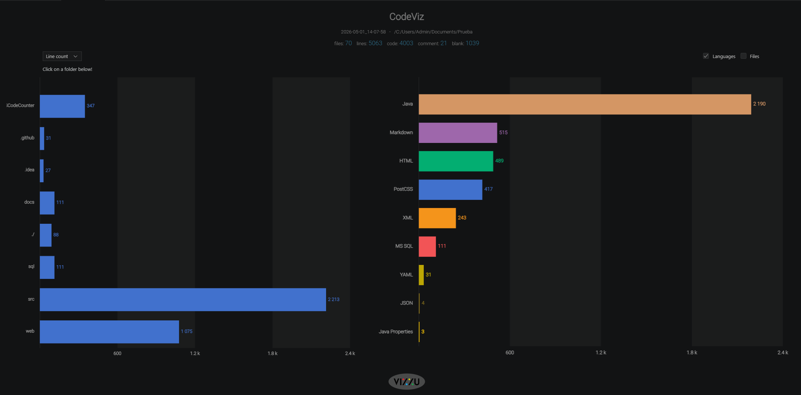

<div align="center">

# 🌸 Floristería La Bajo — Web Portal & ERP Management System


<br/>


**Floristería La Bajo** is an end-to-end intermodular platform developed for an eco-friendly flower shop.  
It unifies a responsive **customer-facing web storefront (HTML5 & CSS3)** with a **transactional back-office management application (Java, JDBC & MySQL)** for inventory control, customer & employee records, and point-of-sale order processing.

</div>

---

## 📑 Table of Contents

- [About the Project](#-about-the-project)
- [Tech Stack](#-tech-stack)
- [Project Structure](#-project-structure)
- [Database Architecture](#-database-architecture)
- [Backend Features (Java + JDBC)](#-backend-features-java--jdbc)
- [Frontend Storefront (HTML5 + CSS3)](#-frontend-storefront-html5--css3)
- [Getting Started](#-getting-started)
- [Codebase Metrics](#-codebase-metrics)
- [Author](#-author)

---

## 📌 About the Project

**Floristería La Bajo** models a real-world floral business specializing in sustainably grown, single-stem and custom-arranged flowers. The repository integrates three core layers:

1. **Digital Storefront (`/web`):** A responsive, multi-page web portal showcasing the flower catalog, brand values, and order/contact inquiry form.
2. **Relational Database (`/sql`):** A normalized **MySQL** database (`floristerialabajo`) with DDL schema scripts, initial seed data, and business intelligence SQL queries.
3. **Management Application (`/src`):** A layered **Java (DAO + Service + View)** console ERP connected via **JDBC**, featuring full CRUD operations for every entity and ACID-compliant multi-item sales transactions with automatic stock deduction.

---

## 🛠️ Tech Stack

| Layer | Technologies |
|---|---|
| **Frontend Web Portal** | Semantic **HTML5**, Custom **CSS3** (CSS Variables, Grid, Flexbox, Keyframe Carousel, Responsive Breakpoints) |
| **Backend Application** | **Java 25 LTS**, **JDBC** (`mysql-connector-j`), **Maven** |
| **Database & Persistence** | **MySQL 8+**, Relational Modeling (E-R & Relational Schemas), **DBeaver** |
| **Architecture Pattern** | Layered Architecture: `model` · `dao` · `service` · `view` · `database` · `util` |

---

## 📁 Project Structure

```text
FloristeriaLaBajo/
├── README.md
├── pom.xml                          # Maven configuration & JDBC dependencies
├── web/                             # Customer-facing web portal (HTML5 / CSS3)
│   ├── index.html                   # Landing page & animated catalog showcase
│   ├── flores.html                  # Full flower catalog with pricing & stock badges
│   ├── nosotros.html                # Brand story & sustainability values
│   ├── contacto.html                # Custom order & inquiry form
│   ├── styles.css                   # Responsive design system & animations
│   └── images/                      # Custom SVG floral illustrations & branding
├── sql/                             # MySQL database scripts
│   ├── schema.sql                   # DDL script (tables, PKs, FKs, constraints)
│   ├── data.sql                     # Initial seed data for all 5 tables
│   └── queries.sql                  # 10 analytical & operational SQL queries
├── diagramas/                       # Entity-Relationship & Relational diagrams
└── src/main/
    ├── resources/
    │   └── config.properties        # Database connection parameters
    └── java/org/floristerialabajo/
        ├── Main.java                # Application entry point
        ├── database/DBConnection.java
        ├── model/                   # Domain entities (Flor, Cliente, Trabajador, Compra, FlorCompra)
        ├── dao/                     # JDBC Data Access Objects withPreparedStatement
        ├── service/                 # Business logic, validation & ACID sales transactions
        ├── util/InputUtil.java      # Safe CLI input parsing & validation helpers
        └── view/MenuPrincipal.java  # Interactive management console UI
```

---

## 🗄️ Database Architecture

The **MySQL** schema (`floristerialabajo`) consists of 5 relational tables enforcing referential integrity (`InnoDB`):

- **`flores`**: Flower catalog (`id_flor`, `nombre`, `precio`, `cantidad`).
- **`clientes`**: Registered customers (`id_cliente`, `dni` UNIQUE, `nombre`, `apellidos`, `email`).
- **`trabajadores`**: Store employees (`id_trabajador`, `dni` UNIQUE, `nombre`, `apellidos`, `telefono`, `email`, `fecha_contratacion`, `fecha_baja`).
- **`compras`**: Sales headers linking employee and customer (`id_compra`, `id_trabajador`, `id_cliente`, `metodo_pago` ENUM, `fecha`, `importe`).
- **`florescompras`**: Composite-key line items (`id_compra`, `id_flor`, `cantidad`).

### Entity-Relationship & Relational Diagrams

<div align="center">
  
  &nbsp;
  
</div>

---

## ⚙️ Backend Features (Java + JDBC)

- **Complete CRUD Modules:** Dedicated management menus for **Flowers**, **Customers**, **Employees** (including employee termination date validation), **Purchases**, and **Purchase Line Items**.
- **Transactional Point-of-Sale (`VentaService`):**
  - Uses explicit JDBC transaction boundaries (`setAutoCommit(false)`, `commit()`, `rollback()`).
  - Verifies employee active status, customer existence, payment method validity (`efectivo`, `tarjeta`, `transferencia`), and real-time flower stock availability.
  - Inserts the sale header, persists each line item in `florescompras`, and atomically deducts sold quantities from `flores`.
- **SQL Injection Prevention:** All database operations use parameterized `PreparedStatement` queries.

---

## 🌐 Frontend Storefront (HTML5 + CSS3)

- **Home (`web/index.html`):** Hero banner, specialty highlights, infinite-scroll SVG flower carousel, and core ecological values.
- **Catalog (`web/flores.html`):** Responsive 4-column product grid displaying custom SVG flower illustrations, availability badges, unit prices, and stock counts.
- **About Us (`web/nosotros.html`) & Contact (`web/contacto.html`):** Company heritage and validated order inquiry form.

---

## 🚀 Getting Started

### 1. Database Setup (MySQL)

Run the SQL scripts in order against your local MySQL instance:

```bash
mysql -u root -p < sql/schema.sql
mysql -u root -p < sql/data.sql
```

### 2. Configure JDBC Credentials

Check or update [`src/main/resources/config.properties`](src/main/resources/config.properties):

```properties
db.url=jdbc:mysql://localhost:3306/floristerialabajo
db.user=root
db.password=your_password
```

### 3. Build & Run the Java Application

```bash
mvn clean compile exec:java -Dexec.mainClass="org.floristerialabajo.Main"
```

### 4. Open the Web Storefront

Open [`web/index.html`](web/index.html) directly in any modern browser or serve the `web/` directory with a local static server.

---

## 📊 Codebase Metrics

<div align="center">
  
</div>

- 📋 [Project Backlog](docs/BACKLOG.md)

---

## 👤 Author

**Pablo Tomé Manzano**  
Intermodular Project · Web Application Development (DAW).

- GitHub: [@pablotome8](https://github.com/pablotome8)
